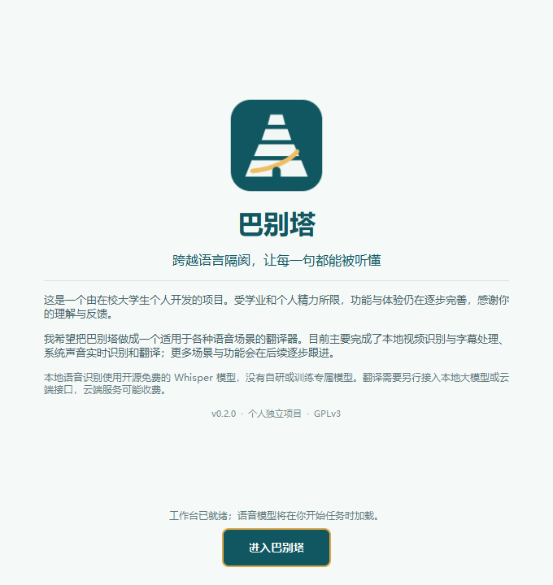
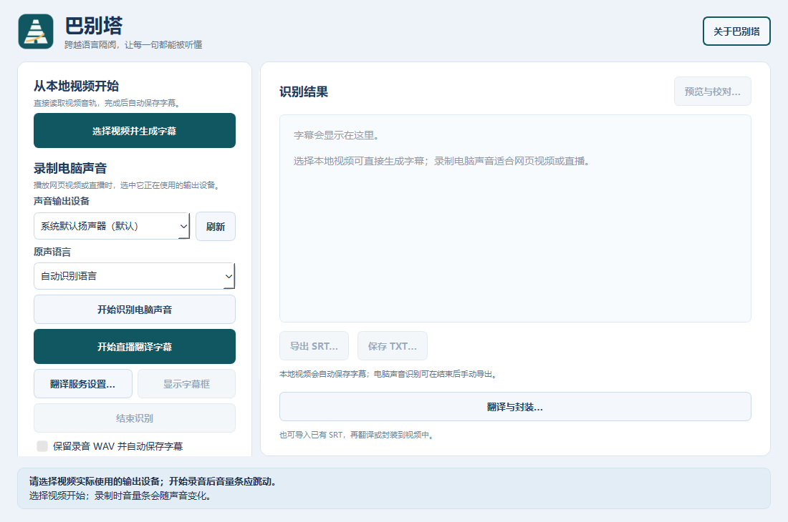

# 巴别塔

<p align="center"></p>
<p align="center"><strong>跨越语言隔阂，让每一句都能被听懂</strong></p>

巴别塔是一个由在校大学生个人开发的 Windows 语音识别与翻译应用。受学业和个人精力所限，功能与体验仍在逐步完善。我希望把它做成适用于各种语音场景的翻译器；当前主要完成了**本地视频识别与字幕处理**、**系统声音实时识别与翻译**，更多功能会逐步跟进。

当前版本：**v0.2.0，公开预览版**。本地语音识别使用开源免费的 Whisper 模型，没有自研或训练专属识别模型。实时和字幕翻译需要用户另行接入云端接口或本地大模型，云端服务可能收费。

<details>
<summary>查看启动页与工作台</summary>

<p></p>
<p></p>
</details>

## 下载与开始使用

从 [Releases](https://github.com/luoyeguishanhe/-/releases) 获取 Windows 64 位便携包。完整解压后双击 `巴别塔/巴别塔.exe`，保留同目录的 `_internal`、`models` 和说明文件；无需安装 Python。启动页会展示项目介绍，组件准备完成后点击“进入巴别塔”。主界面右上角可再次打开“关于巴别塔”。

- **处理本地视频**：选原声语言 → “选择视频并生成字幕” → 等待完成。程序自动在视频旁保存 TXT、SRT，已有文件会另存编号版。需要中文译文时再打开“翻译与封装…”，配置翻译服务。
- **看直播或网页视频**：选播放器实际使用的声音输出设备与原声语言 → “翻译服务设置…” → “开始直播翻译字幕”。字幕框可拖动、隐藏、重新显示；无需选择录音保存位置。
- **结束直播识别**：点击“结束识别”，等待最后一段。需要保留原文时手动导出 TXT/SRT；临时录音会在退出或下次任务时清理。

第一次使用建议先阅读 [完整使用教程](docs/使用教程.md)，尤其是输出设备、翻译接口和字幕时间同步的说明。

## 目前可以做什么

| 功能 | 当前实现 |
| --- | --- |
| 视频识别 | 直接读取本地视频音轨，使用 Whisper small 识别，输出 TXT/SRT |
| 实时字幕 | 采集选中 Windows 输出设备的声音，逐段识别，翻译后显示在可拖动悬浮框中 |
| GPU 加速 | 系统声音模式优先使用 NVIDIA CUDA / float16，不可用时回退 CPU 并说明原因 |
| 翻译模型 | 千问云端、Ollama 本地、自定义兼容 `/chat/completions` 的接口 |
| 字幕编辑 | 本地媒体预览、逐条修改文字及起止时间、另存校对版 SRT |
| 字幕封装 | 将原文或完整译文作为可开关字幕轨封装进新 MKV，视频不重新编码 |
| 用量与费用 | 显示接口报告的 token；批量翻译支持用户填写单价、估算费用和导出报告 |
| 学习与对比 | 对同批录音比较识别模型，生成耗时和人工参考文字评分报告 |

带 small 模型的包可离线识别，GPU 包附带 CUDA 运行库，仍需兼容的 NVIDIA 显卡与驱动。base、medium 未随包提供。Ollama 与翻译模型需自行安装、启动；便携包不附带翻译服务 Key 或本地翻译大模型。

## 实际限制

- 实时字幕仍需等待语音分段、识别和翻译，不是零延迟。识别与翻译各只保留一个等待项，跟不上时跳过旧的等待项，以避免延迟持续积累；状态栏显示后端、耗时、排队与跳过数量。
- 直播译文目前只显示在悬浮框，不自动保存译文 SRT。需要完整译文字幕时，使用本地视频流程后批量翻译。
- 日语口语、朗诵、配乐、人声重叠、生僻词可能识别或翻译不准；接口模型必须按要求返回带编号的 JSON。字幕时间仍可能需要校对。
- 系统录音无法跟踪播放器暂停、跳转和倍速；已有视频优先使用直接导入，时间轴更可靠。直播原文导出使用片段时间，文件模式保留逐词时间戳。
- 当前没有视频字幕烧录、安装向导、自动更新或多音轨选择。文件模式使用完整 CPU 识别配置，不丢弃文件片段。

## 数据与费用

本地识别在电脑上完成。使用云端翻译时，仅向用户配置的服务发送识别文字，不发送本应用采集的音频或视频。Key 仅保留在当前运行内存中；临时录音位于程序 `cache` 会话目录，正常退出或开始下一次任务时清理。崩溃或断电可能留下缓存，可在确认程序已退出后自行删除对应会话目录。

“开源免费识别模型”不代表云端翻译免费。接口未返回的用量显示为未知，费用估算不替代服务商账单。详情见 [Token 用量与费用](docs/Token用量与费用.md)。

## 开发历程与教程

- [详细开发历程](docs/开发历程.md)：从 Python 窗口与系统录音，到 VAD/ASR、模型对比、字幕导出、翻译、打包和 GPU 优化。
- [完整使用教程](docs/使用教程.md)：视频识别、实时翻译、导出、校对、封装、模型接口与常见问题。
- [模型对比入门](docs/模型对比入门.md)、[字幕校对入门](docs/字幕校对入门.md)、[字幕封装与翻译](docs/字幕封装与模型翻译入门.md)。
- [实时性能优化](docs/实时性能优化.md)：队列策略、GPU 回退及单个样本的实测结果。
- [Windows 打包与构建](docs/Windows打包.md)、[v0.2.0 更新说明](docs/发布说明-v0.2.0.md)。

## 从源码运行

需要 Windows 64 位和 Python 3.11 或更新版本，在项目目录运行：

```powershell
python -m venv .venv
.venv\Scripts\python -m pip install -e ".[gpu]"
.venv\Scripts\python -m subtitle_app
```

仅使用 CPU 可将安装命令改为 `pip install -e .`。首次使用未缓存的模型需要下载；选定模型就绪后才开始录音。内部包名和用户数据目录继续沿用 `SubtitleApp`，兼容早期设置和模型缓存。运行测试：`.venv\Scripts\python -m unittest discover -s tests -q`。

## 独立实现、许可与致谢

巴别塔是独立项目，未直接复制或合并 LiveTranslate 的应用源代码，不是其代码库的 fork。项目最初受 [LiveTranslate](https://github.com/TheDeathDragon/LiveTranslate) 使用体验启发；本仓库独立实现音频采集、语音队列、字幕流程、界面与打包，并在开发中使用 AI 编程辅助工具。

项目自身源代码采用 [GPLv3](LICENSE)；第三方库和模型保留各自许可。感谢 Whisper、faster-whisper、CTranslate2、PyQt6、PyAV、OpenCC 等开源项目。详见 [项目来源与声明](NOTICE.md)、[第三方组件](packaging/THIRD_PARTY.md)。

欢迎通过 [Issues](https://github.com/luoyeguishanhe/-/issues) 反馈问题。请描述版本、操作步骤、实际结果及底部耗时信息，分享日志前检查其中是否包含个人信息或接口密钥。
